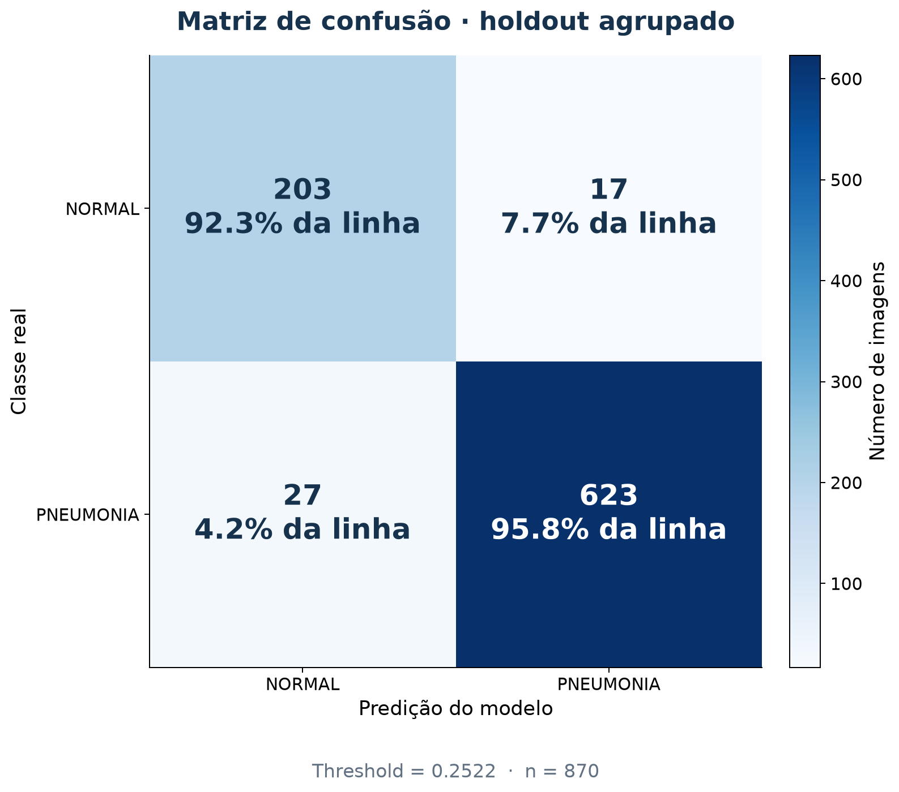
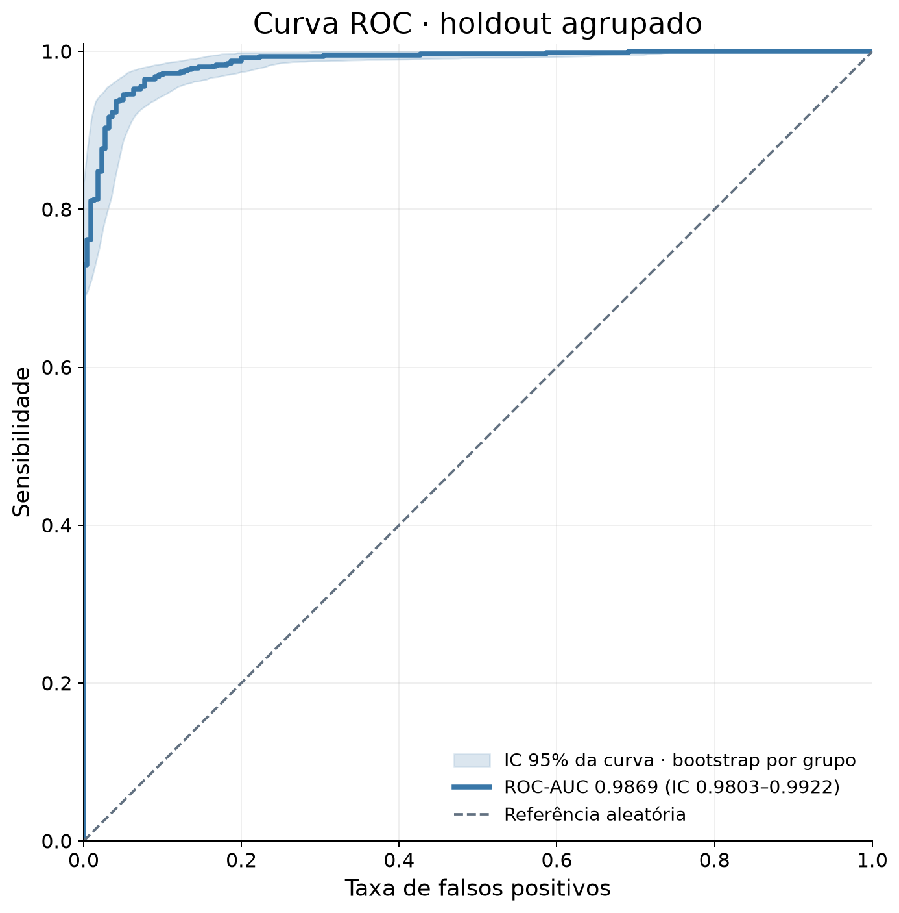
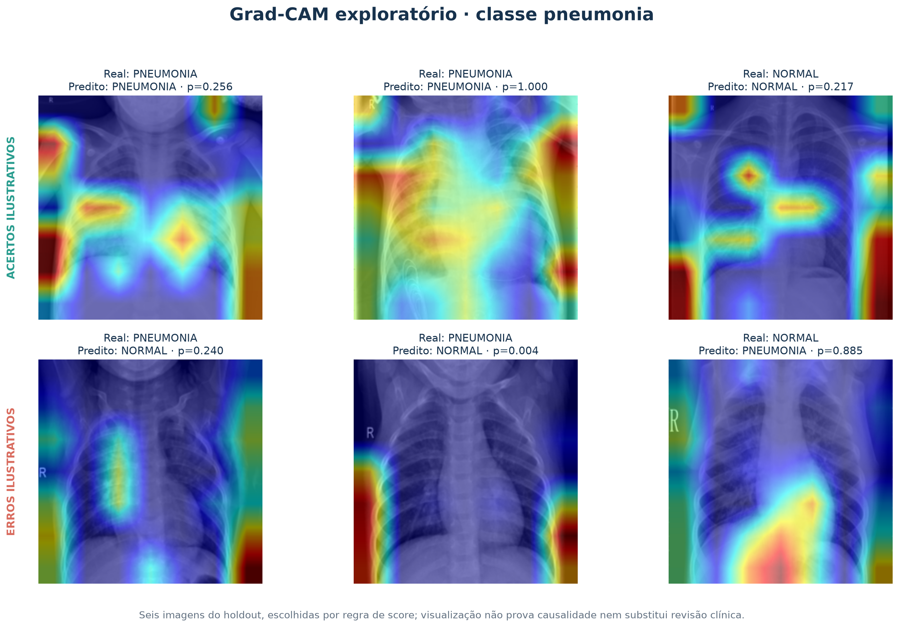
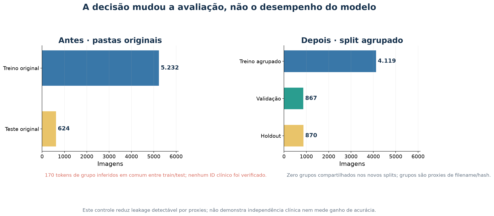

# Pediatric Pneumonia X-ray Classification

**Demo pública:** [Abrir o classificador educacional no Streamlit](https://pneumonia-xray-demo-ruan-2026.streamlit.app/) · [Checkpoint educacional v0.1.0](https://github.com/rodriguesruan/pneumonia-xray/releases/tag/v0.1.0) (SHA-256 verificado). Os pesos pré-treinados incluem parâmetros derivados de ImageNet; confira os termos aplicáveis antes de reutilizar o modelo.

## Figuras do projeto

As figuras abaixo foram confirmadas em `reports/figures/`. Grad-CAM é uma visualização exploratória e não comprova que o modelo usa apenas a anatomia relevante.

### Matriz de confusão

### Curva ROC com intervalo de confiança

### Grad-CAM: exemplos exploratórios

### Antes e depois do split agrupado

Projeto educacional de classificação binária de radiografias pediátricas de tórax (NORMAL vs PNEUMONIA), com PyTorch e transfer learning. O objetivo é praticar avaliação reprodutível; a auditoria sistemática de atalhos visuais está planejada, não foi concluída. O projeto não produz diagnóstico clínico.

> **Aviso:** demonstração educacional; não é dispositivo médico, não deve orientar diagnóstico ou tratamento e não substitui avaliação profissional.

## Escopo

- Dataset: Kermany, Zhang & Goldbaum (2018), [Mendeley Data v2](https://data.mendeley.com/datasets/rscbjbr9sj/2), licença indicada CC BY 4.0. As imagens de Grad-CAM são derivados visuais de exemplos desse dataset; o projeto não redistribui os arquivos originais.
- População: radiografias pediátricas de origem limitada a um centro; resultados não se generalizam automaticamente.
- Tarefa: NORMAL/PNEUMONIA. Etiologia bacteriana/viral fora do escopo.
- Partições: o detector encontrou overlap de tokens de paciente/estudo inferidos entre pastas públicas originais. Por segurança, o pipeline redividiu todos os arquivos por grupos; não tratou o teste publicado como independente.
- Métricas: sensibilidade, especificidade, precisão, F1, ROC-AUC, PR-AUC e Brier score. Threshold e calibração foram definidos na validação. O holdout final foi avaliado uma vez.

## Resultado do holdout agrupado

MobileNetV3 Small pré-treinada, backbone congelado; checkpoint da época 11. O treino foi interrompido manualmente após 13 épocas concluídas, antes da paciência de early stopping configurada (5) encerrar. O threshold de 0,2522 foi escolhido na validação para alvo exploratório de sensibilidade de 95%.

| Métrica | Resultado | IC 95% bootstrap agrupado |
|---|---:|---:|
| Sensibilidade | 95,85% | 94,11–97,27% |
| Especificidade | 92,27% | 88,43–95,56% |
| Precisão | 97,34% | 95,95–98,56% |
| F1 | 96,59% | 95,43–97,56% |
| ROC-AUC | 0,9869 | 0,9803–0,9922 |
| PR-AUC | 0,9956 | 0,9928–0,9975 |
| Brier score | 0,0537 | 0,0430–0,0661 |

Holdout n=870; 623 verdadeiros positivos, 203 verdadeiros negativos, 17 falsos positivos e 27 falsos negativos. Intervalos: 2.000 réplicas bootstrap por grupo. São resultados deste holdout interno, não evidência clínica nem validação externa. Veja `docs/model_card.md` para configuração, limitações e detalhes.

## Preparação e execução

1. Baixe a versão licenciada e extraia a pasta `chest_xray/` em `data/raw/`, com subpastas `train` e `test` e classes `NORMAL` e `PNEUMONIA`.
2. Use Python 3.11–3.13 e instale `requirements.txt`, selecionando a variante PyTorch adequada à sua CPU/GPU no instalador oficial. O ambiente usado neste experimento foi Python 3.13.5 com PyTorch CPU 2.14.1 e TorchVision 0.29.1.
3. Audite: `python -m src.data.audit`.
4. Gere splits agrupados: `python -m src.data.make_splits`.
5. Treine: `python -m src.training.train`. Para smoke test, use `python -m src.training.train --debug`.
6. Gere calibração e threshold na validação: `python -m src.evaluation.run_evaluation --checkpoint runs/<run>/best.pt --split val`.
7. Avalie o holdout uma única vez: `python -m src.evaluation.run_evaluation --checkpoint runs/<run>/best.pt --split test --final-test`.
8. Rode a demo local após instalar as dependências: `streamlit run app/streamlit_app.py`.

O split do experimento foi gerado em `data/processed/splits.csv`; auditoria em `reports/data_audit/`. Checkpoints, dataset e resultados detalhados estão excluídos do Git por padrão. O checkpoint selecionado está configurado em `configs/app.yaml` e existe localmente neste workspace.

## Documentação

- `docs/project_plan.md`: fases e critérios.
- `docs/decisions.md`: escolhas e revisões metodológicas.
- `docs/dataset_datasheet.md`: origem, composição e limitações dos dados.
- `docs/model_card.md`: modelo, avaliação e uso fora do escopo.
- `docs/lessons_learned.md`: resultados e lições do experimento.

## Testes

Com PyTorch instalado: `.venv/Scripts/python.exe -m pytest -q --basetemp=work/pytest-tmp -o cache_dir=work/pytest-cache` (20 testes passaram no ambiente deste projeto; um aviso informa que `pin_memory` não é usado sem acelerador).
